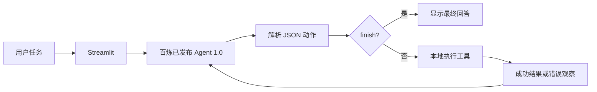

# 智能体设计分析：对应 ai-agent-book 的哪些思想

参考书为李博杰的开源项目 [bojieli/ai-agent-book](https://github.com/bojieli/ai-agent-book)《深入理解 AI Agent：设计原理与工程实践》，重点依据[第一章](https://github.com/bojieli/ai-agent-book/blob/main/book/chapter1.md)中的组件划分、Agent 与环境、Model–Harness 和控制循环。本报告为自己的工程映射，不代表书籍作者对项目的评价。

## 1. LLM + 上下文 + 工具

百炼已发布应用内的大模型负责选择动作；系统提示词、用户任务、云端 session 历史和工具观察构成上下文；本地文件和命令接口构成工具。Streamlit 是用户交互入口。

| 书中概念 | 本项目实现 | 可检查的证据 |
|---|---|---|
| LLM / 决策内核 | 百炼 Agent 1.0 内配置的模型 | 应用发布配置与实际 API 响应 |
| 上下文构造 | 系统提示词、协议、任务和工具观察 | `prompts/flowagent_system.md`、`run_agent` 的 prompt |
| 工具 / 行动接口 | 列目录、读写文件、ZIP、可选 shell | `WorkspaceTools.execute` |
| Environment | 本地文件系统和 shell 运行环境 | 实际文件及命令输出 |
| Harness | 调用适配、动作解析、循环预算和反馈 | `bailian_client.py`、`local_agent.py` |

云端应用不会自动获得本地权限。本地程序解释应用返回的 JSON 并执行，结果再进入下一次应用请求。环境的真实状态在本机，模型只通过工具观察接收信息。

## 2. 模型控制动作—观察循环

模型决定下一步读取、写入还是结束，程序执行确定的工具分派，并将观察返回模型。因此控制流程不是开发者预先固定的 DAG。`FlowAgent` 是平台产品分类，不能仅凭名称将实现认定为固定工作流。

它具有 ReAct 的“选择动作—获得观察—调整动作”特征，但没有实现原论文完整的显式 Thought/Action/Observation 文本协议，也不展示隐藏思维链。此处只展示可审计的动作、参数与工具结果。

## 3. Model 与 Harness 分离

`BailianClient` 管理平台调用和 `session_id`；`run_agent` 管理循环和退出；`WorkspaceTools` 管理实际执行；`app.py` 负责展示。更换界面不会改变动作循环，更换模型也无需重写文件操作。

与视频的最小循环相比，工程层增加 JSON 验证、路径检查、shell 默认关闭、步数限制、命令超时和错误反馈。这些体现书中约束、验证、纠正的思想。它们是基础保护，不构成完整的生产沙箱：shell 开启后可操作当前用户权限下的其他位置；输出截断也无法限制子进程产生的所有资源消耗。

## 4. 上下文与会话记忆

客户端复用百炼返回的 `session_id`，由服务端管理会话上下文；UI 消息列表用于展示和导出，没有重复把整个历史塞回请求。切换模式和开始新对话会清空会话。该实现没有跨会话长期记忆，也没有向量数据库。

## 5. 验证与能力边界

测试通过实际读取文件和检查 ZIP 内容验证执行器，通过脚本化响应检查错误纠正及循环退出。离线验证不能证明大模型在开放任务上的成功率；云端应用仍须实际发布并调用验证。

普通对话模式只是百炼应用的对话入口。如果云端未启用工具，它没有在本机执行动作。只有本地工具模式运行起来，才能依据动作日志与产物说明这里形成了完整的工具闭环。未配置知识库时不称为 RAG；未实现调度与社会软件接入时，不声称是完整 OpenClaw。

若后续评估，可固定“读写后校验”“缺失文件”“越界路径”“打包后校验”等任务，分别记录模型动作成功率、轮数、耗时及失败原因，以避免用单个漂亮演示代替系统评测。
